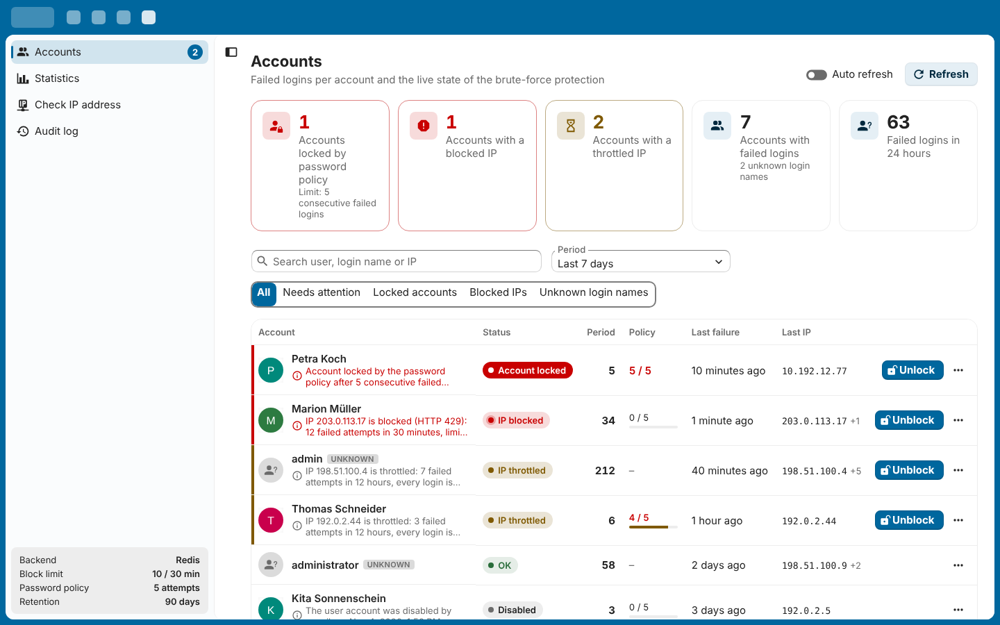
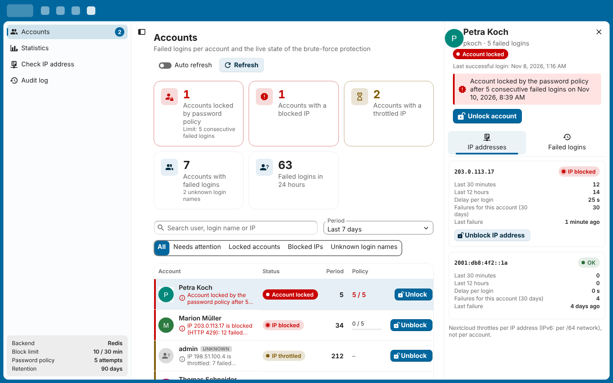
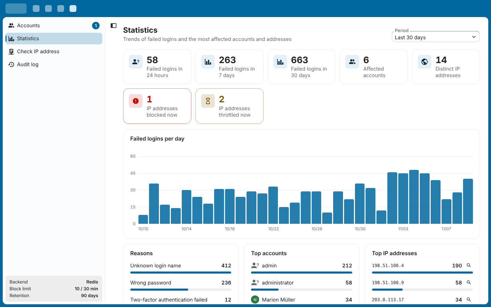

<!--
  - SPDX-FileCopyrightText: 2026 Yannik / Nexus Building
  - SPDX-License-Identifier: AGPL-3.0-or-later
-->
# Login Guard for Nextcloud

**Who failed to log in, how often, from where – and why are they blocked right now?**

Login Guard records failed logins per account and shows the live state of Nextcloud's brute-force protection. Admins – and groups you delegate access to, e.g. a helpdesk – can unblock accounts or IP addresses with one click.



## Features

- Per-account overview of failed logins with last IP, client and reason (wrong password, unknown login name, disabled account, failed 2FA)
- Live brute-force state per IP – *throttled* (with the current delay) or *blocked* (HTTP 429) – read through `OCP\Security\Bruteforce\IThrottler`, so it works with the database **and** the Redis backend
- Unblock an account (all its IPs of the last 48 h) or a single IP; optionally re-enable disabled accounts
- Statistics, IP check and an audit log of all actions
- Delegation to groups in *Administration settings → Security*
- English and German translations

| Details | Statistics |
|---|---|
|  |  |

## Requirements

- Nextcloud 31 – 35
- PHP 8.1+

## Good to know

- Nextcloud throttles **per IP address** (IPv6: per /64 network), not per account. Unblocking therefore also unblocks other users behind the same address.
- Behind a reverse proxy, `trusted_proxies` and `forwarded_for_headers` must be configured – otherwise every failed login is attributed to the proxy and everybody gets throttled at once. Login Guard warns about this.
- Failed logins are recorded from the moment the app is enabled. The *IP check* also shows attempts from before that.
- `IThrottler::getAttempts()`, `getDelay()` and `resetDelayForIP()` are marked internal since Nextcloud 28, but are the only public way to read the throttling state (they are also used by `occ security:bruteforce:*`).

## Installation

From the Nextcloud App Store: *Apps → Security → Login Guard*.

Manually (Docker):

```bash
tar -xzf nexusloginguard-1.0.0.tar.gz
docker cp nexusloginguard nextcloud:/var/www/html/custom_apps/
docker exec nextcloud chown -R www-data:www-data /var/www/html/custom_apps/nexusloginguard
docker exec -u www-data nextcloud php occ app:enable nexusloginguard
```

## License

AGPL-3.0-or-later
